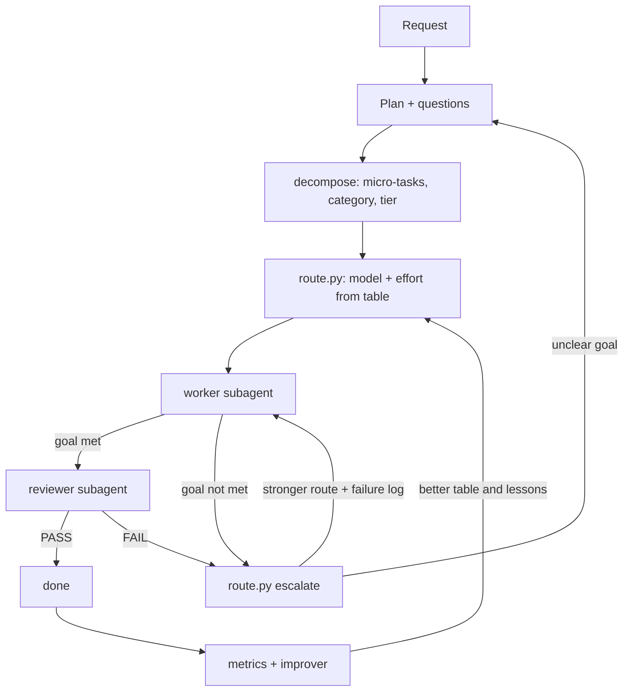
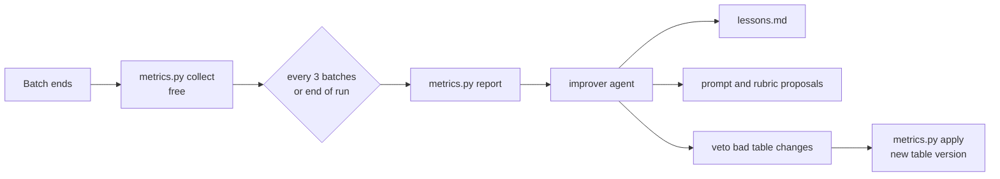

# Claude Token Reduction Bundle — `token-routing`

[](https://github.com/Marco-Bonito/Claude_token_reduction_bundle/actions/workflows/test.yml)


A Claude Code plugin that sends each task to the **cheapest model and effort level that can do it**, checks the result, retries with a stronger route only when needed, and **learns from every run**.

**Visual guide:** [`docs/index.html`](docs/index.html) · **Token-saving guide:** [`docs/token-saving.md`](docs/token-saving.md)

## Why

On long coding runs, most of the cost comes from using a strong model for easy work, and from a main context that grows with every file and log. This plugin:

- splits a request into micro-tasks, each with a goal and an acceptance check;
- gives each task a category and a complexity tier (1–5);
- picks model + effort from a table, with a script (no model tokens spent on routing);
- runs each task in its own subagent, so the main context stays small;
- reviews the result, and escalates only on failure (max 2 retries);
- tunes the table from real results, with guardrails and rollback.



## Install

### Option A: plugin (recommended)

In Claude Code:

```
/plugin marketplace add Marco-Bonito/Claude_token_reduction_bundle
/plugin install token-routing@token-routing
```

Restart Claude Code. To update later: `/plugin marketplace update token-routing`.

### Option B: manual copy into one project

```bash
git clone https://github.com/Marco-Bonito/Claude_token_reduction_bundle.git
cd Claude_token_reduction_bundle
scripts/install.sh /path/to/your/project                 # macOS / Linux
# Windows:
# powershell -ExecutionPolicy Bypass -File scripts\install.ps1 C:\path\to\your\project
```

### Then, for both options

1. Paste [`plugins/token-routing/CLAUDE.routing.md`](plugins/token-routing/CLAUDE.routing.md) into your project's `CLAUDE.md`.
2. Do **not** set `CLAUDE_CODE_EFFORT_LEVEL` or `CLAUDE_CODE_SUBAGENT_MODEL`. They override the per-task values.
3. You need Python 3.9+ and a Claude Code version that accepts `model` and `effort` per subagent call.

## Use

| Step | You do | Claude does |
|---|---|---|
| 1 | `/orchestrate <request>` (one goal per run) | Drafts a plan |
| 2 | Answer max 4 questions | Rewrites the plan, makes high-level tasks |
| 3 | — | Decomposes into micro-tasks, routes each one |
| 4 | Check the route map and the cost profile, say "go" | — |
| 5 | Follow `.claude/runs/<run>/route-map.md` if you want | Runs workers, reviews, retries |
| 6 | — | Runs `/improve` at the end (and every 3 batches) |
| 7 | Approve or reject the proposals, commit `.claude/routing/history/` | Applies the approved changes |

Other commands:

- `/decompose <task>`: only the task breakdown, with tiers and routes.
- `/improve`: run the improvement cycle now.

## The routing table

The file `.claude/routing/routing-table.json` is created in your project on first use. Edit it to tune cost against quality.

| Category | T1 | T2 | T3 | T4 | T5 |
|---|---|---|---|---|---|
| explore | haiku/low | haiku/low | haiku/medium | sonnet/low | sonnet/medium |
| ops | haiku/low | haiku/low | haiku/medium | haiku/high | sonnet/medium |
| browse | haiku/low | haiku/medium | haiku/medium | haiku/high | sonnet/medium |
| docs | haiku/medium | sonnet/low | sonnet/low | sonnet/medium | sonnet/high |
| test | haiku/medium | sonnet/low | sonnet/low | sonnet/medium | opus/medium |
| code | haiku/medium | sonnet/low | sonnet/low | sonnet/high | opus/high |
| refactor | haiku/medium | sonnet/low | sonnet/medium | sonnet/high | opus/high |
| debug | haiku/high | sonnet/low | sonnet/medium | opus/medium | opus/high |
| data | haiku/high | sonnet/medium | sonnet/medium | opus/medium | opus/high |
| architecture | sonnet/medium | sonnet/high | opus/medium | opus/high | opus/xhigh |

Print your current table with `python3 <plugin>/routing/route.py table`.

### Retries depend on the failure type

| Failure type | Meaning | Next route |
|---|---|---|
| `depth` | right approach, incomplete | same model, more effort |
| `capability` | wrong approach | next model |
| `review` | reviewer rejected | like `depth` |
| `environment` | tool, dependency or permission problem | same route once, after a fix |
| `spec` | goal unclear | stop and ask the user |

Max 2 retries per task. Each category has a ceiling, so a docs task never reaches Opus xhigh. On a retry, the worker gets the earlier attempts and their logs.

## The improver



- **Table:** below 60% first-pass success → one step up. Above 95% over 8+ tasks → try one step down.
- **Lessons:** a cause that repeats in 2+ failures becomes a short rule. Workers get it in their brief.
- **Tier drift:** tasks solved 2+ steps above their first route → the rubric underestimates them.
- **Guardrails:** minimum samples, max 1 step per cycle, no automatic ceiling changes, only new data counts after a change, every change is versioned (`metrics.py rollback`), prompt changes need your approval.

## Where things live

| Location | Content |
|---|---|
| Plugin (read-only) | skills, agents, scripts, defaults, templates |
| `<project>/.claude/routing/` | your table, lessons, `history/` (commit this: it is what your project learned) |
| `<project>/.claude/runs/<run>/` | `plan.md`, `tasks.json`, `route-map.md`, `logs/` (commit or ignore, your choice) |

## Repository layout

```
.claude-plugin/marketplace.json     marketplace entry
plugins/token-routing/
  .claude-plugin/plugin.json
  skills/      orchestrate, decompose, improve
  agents/      worker, reviewer, improver
  routing/     route.py, route_map.py, metrics.py, _paths.py, defaults/, templates/
  CLAUDE.routing.md
scripts/       install.sh, install.ps1
tests/         run_tests.py (end-to-end, no dependencies)
docs/          index.html (visual guide), token-saving.md
```

## Notes and limits

- In a plugin install, agent and skill names can show with the prefix `token-routing:`. The skills tell Claude to use the name in its list.
- Token data comes from subagent transcripts (`~/.claude/projects/*/*/subagents/agent-<id>.jsonl`) when the orchestrator records the agent ID, or from the number in the Agent result. If your Claude Code version stores transcripts somewhere else, change `improver.transcripts_glob` in the table.
- `cost_weights` are relative placeholders. Update the ratios when prices change.
- Very small tasks waste tokens, because each subagent start has a fixed overhead. The decompose skill merges them.

## Contributing

Run `python3 tests/run_tests.py` before a pull request. See [CONTRIBUTING.md](CONTRIBUTING.md).

## License

MIT — see [LICENSE](LICENSE).
