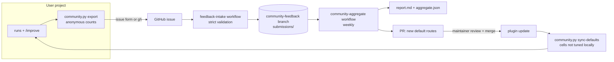

# Community feedback

Every project tunes its own routing table. The community loop shares those results, so the **defaults** and the **task classification** get better for everyone.

## What is shared

`community.py export` writes `.claude/routing/history/community-export.json`. It contains **only**:

| Field | Example |
|---|---|
| Random contributor ID (made once, not linked to you) | `3f2c…` |
| Plugin, table and defaults version numbers | `1.1.0`, `4`, `2` |
| Per category × tier: task count, first-pass count, solved count | `code:3: 9 / 3 / 9` |
| Routes used first and routes that won, as `model/effort` | `sonnet/low: 9` |
| Failure-type counts, average tokens per task | `depth: 6`, `61000` |
| Per category × tier × score pattern: tasks, first pass, winning routes | `code:3:S1 C1 R1 V1` |

It does **not** contain task titles, goals, file names, paths, code, logs, run IDs or dates. Each export is cumulative and **replaces** your earlier one.

## How to share

1. Run `python3 <plugin>/routing/community.py export`. `/improve` offers this after 20+ finished tasks.
2. Open the file and check it.
3. Choose one option:
   - Browser: open the [Routing feedback issue form](https://github.com/Marco-Bonito/Claude_token_reduction_bundle/issues/new?template=routing-feedback.yml), paste the file content, tick the consent box.
   - GitHub CLI: `gh issue create --repo Marco-Bonito/Claude_token_reduction_bundle --title "Routing feedback" --body-file .claude/routing/history/community-issue.md`
4. A bot validates the data, stores it in the `community-feedback` branch, replies and closes the issue.

## How the data improves classification

Drift = (ladder index of the route that solved the task) − (default index for the tier that the rubric gave).

- **Per score component** (`S=2`, `C=1`, `R=2`…): average drift. A clear positive drift means that this component should give more points. A negative drift means fewer points.
- **Per score total** (0–8): average drift. If, for example, total 5 always needs a T4 route, the report suggests that total 5 maps to T4.
- **Per cell**: the weighted median winning route. If it differs from the default, the weekly PR moves the default 1 step toward it.

Rubric findings need a human edit of `plugins/token-routing/skills/decompose/SKILL.md`. Table changes come as an automatic pull request.

## Fairness and safety

- A change needs ≥ 3 different contributors and ≥ 30 weighted tasks in that cell.
- One contributor counts for max 50 tasks per cell, so one heavy user cannot steer the defaults.
- Max 1 ladder step per cell per weekly cycle, never above the category ceiling.
- `feedback-intake` treats the issue body as untrusted: no shell interpolation, JSON only, exact schema, size and value limits.
- Nothing changes `main` without a maintainer merging the pull request.
- `sync-defaults` never overwrites a cell that your own improver tuned.

## Maintainer setup (once)

1. Create the label `routing-feedback`. The issue form adds it.
2. In Settings → Actions → General → Workflow permissions: allow "Read and write permissions" and tick "Allow GitHub Actions to create and approve pull requests".
3. The `community-feedback` branch must exist. It does: `submissions/`, `aggregate/`, `README.md`.
4. Optional: protect `community-feedback` so only GitHub Actions can push to it.

Thresholds live in `plugins/token-routing/routing/defaults/routing-table.json` → `community`.
