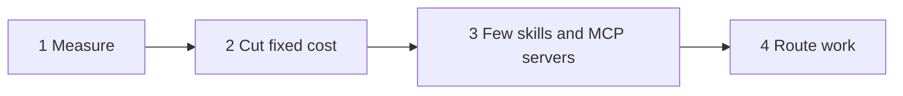

# Token-saving guide for Claude Code

General habits that cut token use on long coding runs. They work with or without the `token-routing` plugin.

## 1. Measure first

- `/usage`: tokens and estimated cost of the session, plus the share of input served from the prompt cache.
- `/context`: what fills the context window: system prompt, CLAUDE.md, MCP servers, subagents, skills.
- A high cache share is good. Do not edit CLAUDE.md in the middle of a session, because a change can invalidate the cache.

## 2. Cut the fixed cost

Every turn sends the context again. A smaller context costs less on every turn.

**Context hygiene**
- `/clear` when you start unrelated work. `/rename` first, and `/resume` later if you need it.
- `/compact Focus on <what matters>` gives a better summary than automatic compaction.
- A `# Compact instructions` section in CLAUDE.md sets standing rules for compaction.
- `/btw` asks a side question without adding it to the history.

**CLAUDE.md**
- Keep it short, like a lookup table: commands, conventions, folders not to touch.
- Move rare knowledge into skills. A skill body loads only when the skill is used.
- `@path` imports do not reduce context. Imported files load with the file that imports them.

**Models**
- Sonnet for most coding. Opus for architecture and hard debugging. Haiku for simple subagent work.
- Subagent model order: per-call parameter → agent frontmatter `model:` → `CLAUDE_CODE_SUBAGENT_MODEL` → main model. The env var also blocks the per-call value, so do not set it if you route per task.
- Effort is a second dial: lower effort costs fewer output tokens for the same model.

**Subagents**
- Send wide code searches and log-heavy work to a subagent. Its file reads stay in its own context, and only the summary comes back.
- Each subagent start has a fixed overhead. Do not spawn one for a 2-step task.

**Hooks**
- A `PreToolUse` hook on `Bash` can filter test output, so Claude sees only the failures. Save the full log to a file.

## 3. Few skills and MCP servers

Each skill description and each MCP server adds a small cost to every turn. Install what you use every week.

- MCP tools are deferred by default: only names load until a tool is used. Still, turn off unused servers with `/mcp`.
- Prefer CLI tools (`gh`, `aws`, `gcloud`) over MCP servers. They add no tool schemas to the context.
- Scope MCP servers: user scope for servers you use everywhere (for example Context7 for library docs), project scope for the rest (for example Playwright).
- For skills you call only by hand, set `disable-model-invocation: true`. This removes the description from the context.
- Keep each SKILL.md under about 500 lines. Move reference material into `references/`. Put the critical rules near the top: after compaction, only the first part of a skill is re-attached.

## 4. Route work

From cheapest to most flexible:

1. **Slash commands and hooks.** You or a script decide. No model tokens spent on the decision.
2. **A routing table in CLAUDE.md.** It loads anyway, so 10 lines cost almost nothing.
3. **A router skill or an orchestrator.** Flexible, but it costs tokens to decide. The `token-routing` plugin keeps that cost low: the decision is a script, and the model only classifies.

## Sources

- [Tips for Token Optimisation in Claude Code — DEV](https://dev.to/vishnub33527201/tips-for-token-optimisation-in-claude-code-1kn5)
- [Claude Code costs docs](https://code.claude.com/docs/en/costs)
- [Tool search by default — Claude Code digest](https://pricci1.github.io/cc-docs-changelog/posts/2026-03-27-003851.html)
- [Subagent model resolution — Claude Code playbook](https://ao92265.github.io/claude-code-playbook/docs/cost-guide/)
- [Per-call subagent effort — wmedia.es](https://wmedia.es/en/tips/claude-code-subagents-cheaper-low-effort)
- [Skill token budgets — Claude skills guide](https://claude-skills-guide-3lc.pages.dev/claude-skills-performance-optimization/)
- [Best MCP servers for Claude Code — Parallel](https://parallel.ai/ai/articles/best-mcp-servers-for-claude-code)
